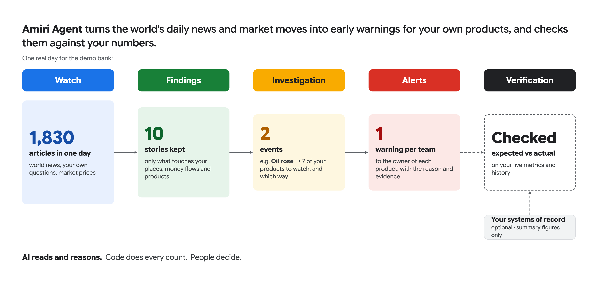
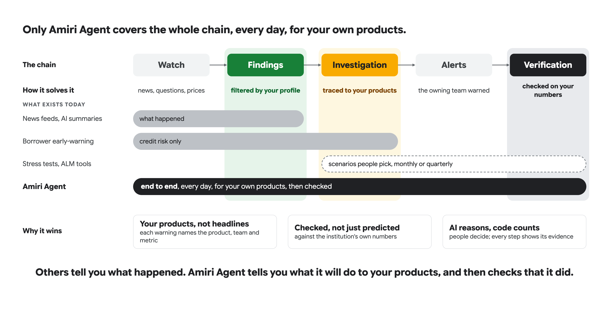
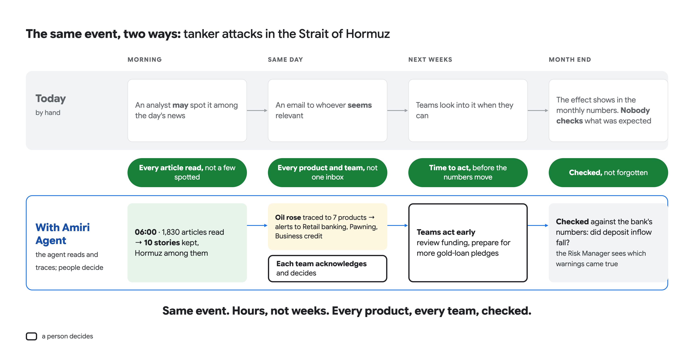
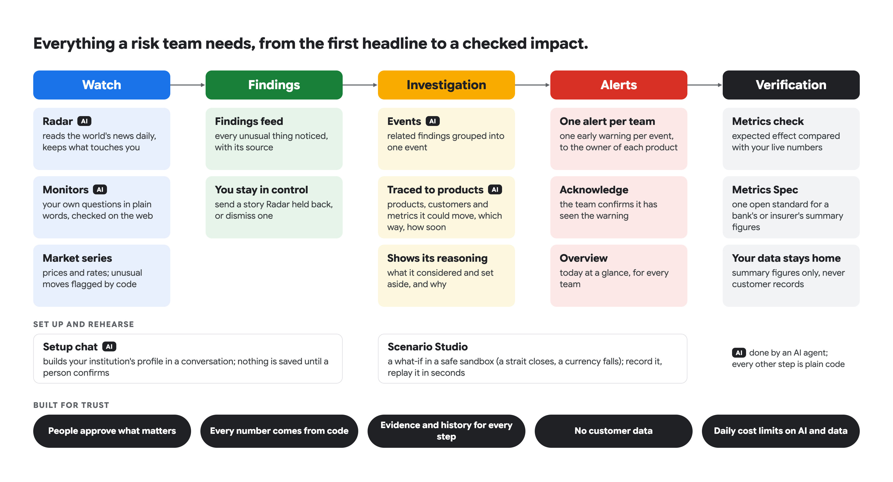
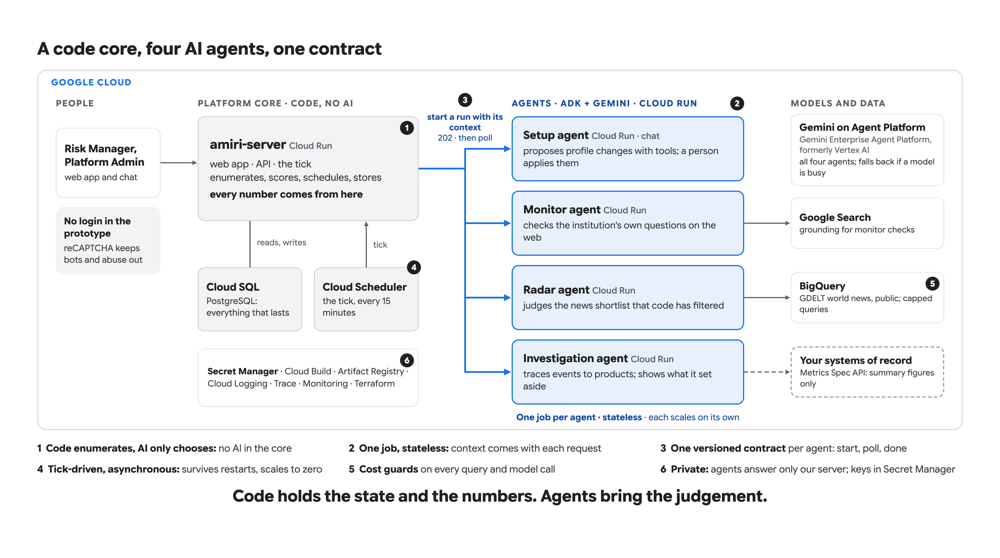
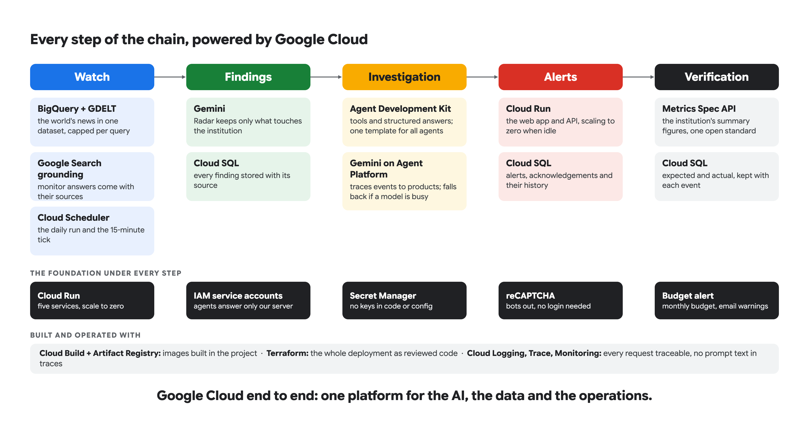
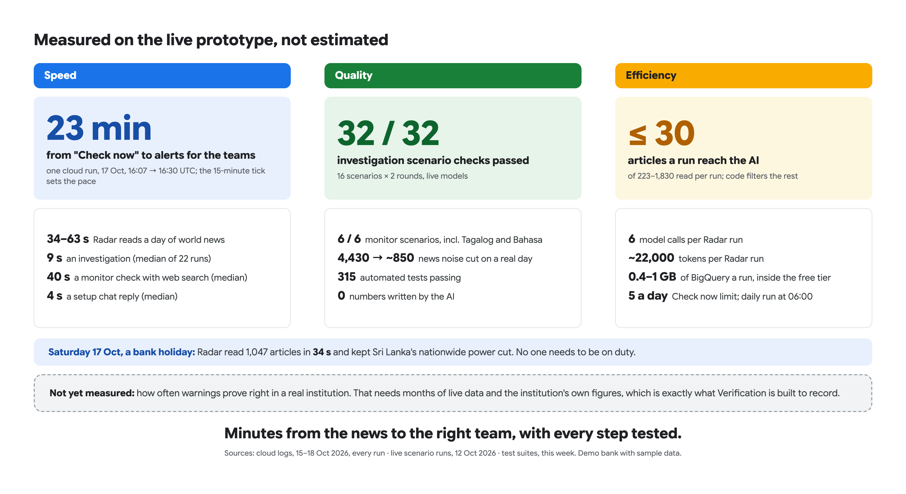
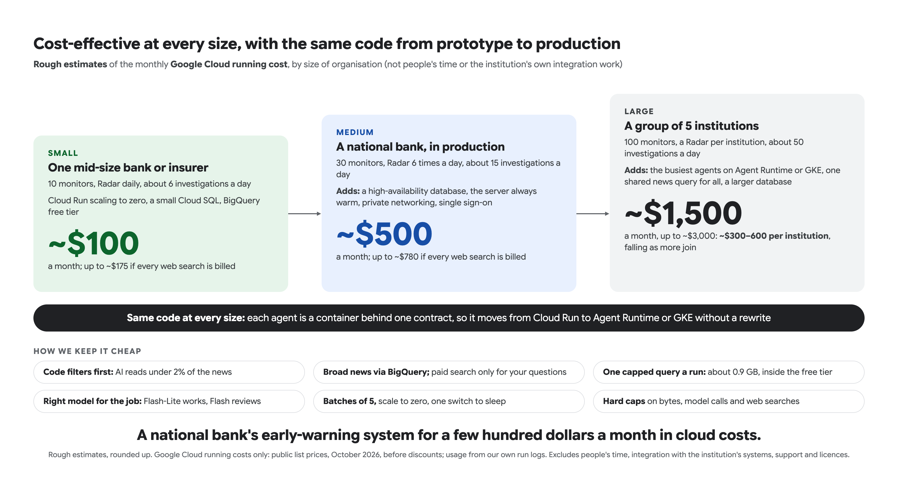
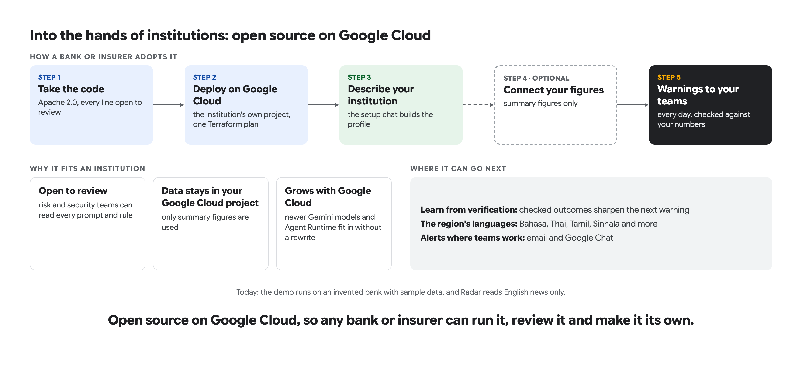

<h1 align="center">Amiri Agent</h1>

<p align="center">
  <b>An AI early-warning analyst for banks and insurers.</b><br/>
  It reads the world's news and market moves every day, traces each event to the institution's own products,<br/>
  warns the team that owns each product, and checks the expected impact against the institution's numbers.
</p>

<p align="center">
  <a href="#our-solution"><b>Our solution</b></a> ·
  <a href="#a-five-minute-tour">Five-minute tour</a> ·
  <a href="#architecture">Architecture</a> ·
  <a href="#the-four-agents-and-their-gemini-models">Agents and models</a> ·
  <a href="#apis-contracts-and-the-metrics-spec">APIs and Metrics Spec</a> ·
  <a href="#references">References</a>
</p>

<p align="center">
  Gemini on Agent Platform · Agent Development Kit · Google Search grounding · BigQuery · Cloud Run · Cloud SQL · Cloud Scheduler · Terraform
</p>

---

## Contents

1. [The problem](#the-problem)
2. [Our solution](#our-solution)
3. [Why it is different](#why-it-is-different)
4. [What it does](#what-it-does)
5. [A five-minute tour](#a-five-minute-tour)
6. [Prototype limitations](#prototype-limitations)
7. [Architecture](#architecture)
8. [The four agents and their Gemini models](#the-four-agents-and-their-gemini-models)
9. [How the server talks to the agents](#how-the-server-talks-to-the-agents)
10. [APIs, contracts and the Metrics Spec](#apis-contracts-and-the-metrics-spec)
11. [Google Cloud, end to end](#google-cloud-end-to-end)
12. [Technical solutions](#technical-solutions)
13. [Measured, not estimated](#measured-not-estimated)
14. [What it costs to run](#what-it-costs-to-run)
15. [Run it yourself](#run-it-yourself)
16. [What comes next](#what-comes-next)
17. [References](#references)

---

## The problem

- **World events hit banks and insurers**, directly and indirectly: a strait closes, a currency falls, a
  regulator acts, a Gulf state cuts foreign workers.
- **Thousands happen every day.** No risk team can read them all, let alone work out which of its own products
  each one could move.
- **Today it's done by hand:** someone *may* spot it, an email goes to whoever *seems* relevant, and the effect
  shows up weeks later in the monthly numbers.
- **Nobody checks afterwards** whether the expected impact really happened.

## Our solution



| Step | What happens | Who does it |
|---|---|---|
| **Watch** | World news (Radar), the institution's own questions (Monitors), and prices and rates (Market series) | AI agents and code |
| **Findings** | Only what touches the institution's places, money flows and products is kept, with its source | Code filters, AI picks what matters |
| **Investigation** | Related findings become one event, traced to the products, customers and metrics it could move, and which way | AI agent, over options code enumerates |
| **Alerts** | One early warning per event to the team that owns each product, with the reason and the evidence | Code |
| **Verification** | Expected vs actual, on the institution's own summary figures | Code |

> **AI reads and reasons. Code does every count. People decide.**

## Why it is different



- **Your products, not headlines:** each warning names the product, the owning team and the metric to watch.
- **Checked, not just predicted:** the expected effect is compared with the institution's own numbers.
- **AI reasons, code counts:** every number on screen comes from code; every step shows its evidence.



## What it does



## A five-minute tour

**In a running deployment** (see [Run it yourself](#run-it-yourself)), with the demo bank loaded: **Serendib
Commercial Bank** (invented, Sri Lanka only).

| # | Go to | Look for |
|---|---|---|
| 1 | **Overview** | Today at a glance: what Amiri Agent watched, found, traced and sent to each team |
| 2 | **Alerts** › open one | The owning team, the product, the direction, *why*, the evidence and its sources; **Acknowledge** |
| 3 | The alert's **event** | The chain: findings → event → products → teams, and what the agent considered and **set aside** |
| 4 | **Radar** | How many articles it read and how many it kept, and why each story matters to this bank |
| 5 | **Monitors** › open one | A plain-language question ("tell me if…"), approved by a person, checked on the web with sources |
| 6 | **Scenario Studio** › **Replay it** | A three-week what-if, replayed in under a minute, with no AI calls and nothing touching live data |
| 7 | **Institution** | The profile every agent works from: footprint, customers, products, money flows (each figure with its source), regulators, rivals, risks |
| 8 | **Data connections** (Platform Admin) | The sample bank's API under the **Metrics Spec**: checked, approved, and feeding Verification |
| 9 | **Metrics Spec** | The open standard for a bank's or insurer's summary figures, with its PDF guide |

**Want the insurer instead?** Settings › **Reset the prototype…** › **Demo insurer: Samudra Raya General
Insurance** (invented, Indonesia only). The demo files and how to load them are in [`demo/`](demo).

## Prototype limitations

| Area | Today |
|---|---|
| **Data** | Two invented institutions with sample data. Real firms appear only as rivals, regulators and partners. |
| **Access** | No login. Anyone with the link uses it as Risk Manager or Platform Admin, including **Reset the prototype**, which reloads a demo. Bots are kept out by a reCAPTCHA check when it's switched on. |
| **Users** | One installation serves one institution. One demo user records every action. |
| **Verification** | Verdicts arrive once the institution publishes the period's figures. A fresh alert shows *"not published yet"* until then. |
| **News** | Radar reads English news. Monitors also read other languages (tested on Tagalog and Bahasa pages). |
| **Pace** | Work runs on a 15-minute tick. From *Check now* to the teams' alerts took 23 minutes in the cloud. |
| **Daily limits** | Radar *Check now* 5 a day; up to 10 live monitors, checked at most hourly, 3 web searches each; up to 8 market series. |
| **Prices** | Market series from Twelve Data's free tier, hourly. FX and gold show *stale* over weekends, when markets close. |
| **Scale** | Each agent runs one instance (its run status lives in memory between *start* and *poll*). |
| **Not yet measured** | How often warnings prove right in a real institution. That takes months of the institution's own figures, which is what Verification records. |

## Architecture



| # | Principle | In practice |
|---|---|---|
| 1 | **Code enumerates, AI only chooses** | The server has no model. It lists what could be affected, and an agent picks from that list with a structured answer. **No number a person reads is written by a model.** |
| 2 | **One job per agent, stateless** | Each agent does one thing and gets all its context with each request. Everything that lasts lives in Cloud SQL. |
| 3 | **One versioned contract per agent** | Start a run → `202` → poll until done. Each contract is an OpenAPI document in this repository. |
| 4 | **Tick-driven and asynchronous** | Cloud Scheduler calls the server every 15 minutes. Work survives restarts, and every service scales to zero. |
| 5 | **Cost guards everywhere** | Capped BigQuery bytes, model calls, web searches and runs a day. |
| 6 | **Private by design** | Agents answer only the server's service account. Keys live in Secret Manager. No prompt text goes into traces. Only summary figures, never customer records. |

## The four agents and their Gemini models

All four are built with Google's **Agent Development Kit (ADK)**, scaffolded with Agents CLI, and run as their own
**Cloud Run** service. Each calls **Gemini on Gemini Enterprise Agent Platform** (formerly Vertex AI) through an
ordered model list. If a model is busy, slow or out of quota, the call moves to the next one.

| Agent | Its one job | Gemini models (tried in order) | Tools and data |
|---|---|---|---|
| **Radar** | Reads a day of world news for the institution's footprint and decides which stories matter, and why | `gemini-3.5-flash-lite` → `gemini-3.1-flash-lite` | One BigQuery query of **GDELT**, built and capped by code. Structured output, no tools. The server sends back the stories already seen. |
| **Monitor** | Checks one plain-language question on the web and reports findings with sources | **Steps:** `gemini-3.5-flash-lite` → `gemini-3.1-flash-lite` · **Web search:** the same, with **Google Search grounding** · **Reviewer** of every finding, stronger first: `gemini-3.8-flash` → `gemini-3.7-flash` → `gemini-3.5-flash` → `gemini-3.1-flash-lite` | Google Search grounding, up to 3 queries a check |
| **Investigation** | Groups findings into events and traces each to products, with direction, timing and the metric to watch; says what it set aside | `gemini-3.5-flash-lite` → `gemini-3.1-flash-lite`, temperature 0, for the *classify*, *screen* and *choose* steps | The institution's profile and the products' Metrics Spec metrics, sent with the request |
| **Setup** | A chat that builds the institution's profile; proposes changes for a person to apply | **Router:** `gemini-3.5-flash-lite` → `gemini-3.1-flash-lite` · **Track agents:** the same | Profile tools on the server; nothing is saved until a person confirms |

## How the server talks to the agents

```mermaid
sequenceDiagram
    autonumber
    participant SCH as Cloud Scheduler
    participant SRV as amiri-server (code)
    participant AG as Agent (ADK + Gemini)
    participant DB as Cloud SQL
    SCH->>SRV: tick (every 15 min, OIDC)
    SRV->>DB: what is due? (monitor checks, investigations, Radar run)
    SRV->>AG: POST /… start a run, with all its context (ID token)
    AG-->>SRV: 202 Accepted (run_id)
    Note over AG: works in the background:<br/>Gemini, Google Search, BigQuery
    SRV->>AG: GET /…/{run_id} on the next tick (or when a page asks)
    AG-->>SRV: done: structured result
    SRV->>DB: store findings, events, alerts; code does every count
```

| Agent | Contract | Start | Poll |
|---|---|---|---|
| Radar | [`radar-agent-openapi.yaml`](server/contracts/radar-agent-openapi.yaml) · v2.1 | `POST /radar-runs` → `202` | `GET /radar-runs/{run_id}` |
| Monitor | [`openapi.yaml`](agents/event-monitor-agent/openapi.yaml) · v2.0 | `POST /checks` → `202` | `GET /checks/{run_id}` |
| Investigation | [`investigation-agent-openapi.yaml`](server/contracts/investigation-agent-openapi.yaml) · v0.5.0 | `POST /investigations` → `202` | `GET /investigations/{run_id}` |
| Setup | [`setup-agent-openapi.yaml`](server/contracts/setup-agent-openapi.yaml) · v1.0 | `POST /sessions` → `201` | `POST /sessions/{id}/turns` (one chat turn) |

- **Idempotent:** sending the same `run_id` again returns the same run, so a retried tick never doubles the work.
- **Replaceable:** any service that meets a contract can stand in for an agent. The server ships fakes for local
  work (`uv run amiri fake-agent`, `uv run amiri radar-fake`) and conformance checks (`agent-check`,
  `radar-check`).

## APIs, contracts and the Metrics Spec

| What | In this repository | In a running deployment |
|---|---|---|
| **Amiri server REST API** | [`server/openapi.yaml`](server/openapi.yaml) | Interactive docs at `/docs` · `/openapi.json` |
| **Metrics Spec 1.0.0**: which summary figures a bank or insurer exposes, per product category | [Guide (Markdown)](server/app/spec/metrics-spec-1.0.0.md) · [PDF](server/app/spec/metrics-spec-1.0.0.pdf) · [YAML](server/app/spec/metrics-spec-1.0.0.yaml) · [Reference API (OpenAPI)](server/app/spec/reference-openapi-1.0.0.yaml) | **Metrics Spec** page (`/spec`) |
| **Sample bank and insurer**: working Metrics Spec APIs that feed Verification | [`server/app/mockinst/`](server/app/mockinst) | `/mock/bank/openapi.json` · `/mock/insurer/openapi.json` |
| **Agent contracts** | [`server/contracts/`](server/contracts) · [`agents/event-monitor-agent/openapi.yaml`](agents/event-monitor-agent/openapi.yaml) | Served by each agent, to the server only |

**About the Metrics Spec:**
- **Aggregates only:** it serves counts, sums and rates per product and period, never a customer record.
- **Any country:** it names no regulator, calendar or currency as a requirement.
- **Comparable over time:** booking dates, currency conversion and dimensions are defined, so two institutions
  compute the same value from the same records.

## Google Cloud, end to end



| Service | What it does here | Why this one |
|---|---|---|
| **Gemini on Agent Platform** | The four agents' reasoning | Flash and Flash-Lite: low cost, with fallback across models |
| **Agent Development Kit** | Tools, structured answers, one template for all agents | The same shape for every agent, which makes them easy to test |
| **Google Search grounding** | Monitor answers come with their sources | Evidence a person can open |
| **BigQuery + GDELT** | The world's news in one public dataset | Billed per byte; about 0.9 GB a day, inside the free tier |
| **Cloud Run** | Five services: the server and four agents | Scale to zero; far less to run than a cluster |
| **Cloud SQL (PostgreSQL 16)** | Profiles, findings, events, alerts, history | Relational data with history and joins |
| **Cloud Scheduler** | The 15-minute tick (OIDC) | No timers inside the app; restarts lose nothing |
| **Secret Manager · IAM** | Keys; agents answer only the server's service account | No secrets in code, config or Terraform state |
| **Cloud Build · Artifact Registry** | Images built inside the project | No local Docker needed to deploy |
| **Cloud Logging · Trace · Monitoring** | Every request traceable | Prompt text is kept out of traces |
| **reCAPTCHA · Budget alert** | Bots out without a login; a monthly budget with email warnings | Safe to share a link |
| **Terraform** | The whole deployment as reviewed code | One plan, in the institution's own project |

## Technical solutions

The problems we hit running agents on serverless infrastructure, and how we solved them.

| Challenge | What we did |
|---|---|
| **An agent must keep working after it answers `202`**, but Cloud Run slows the CPU down once a response is sent | The agents that work in the background run with CPU **always allocated** (`cpu_idle = false`) and a **startup CPU boost**. The setup chat, which answers in-line, scales CPU down when idle. |
| **Long AI work vs. HTTP timeouts** | Every agent call is **asynchronous**: start → `202` → poll. A chat turn gets up to 600 s on the server. |
| **No always-on process to run schedules** | **Cloud Scheduler** calls `/internal/tick` every 15 minutes with an OIDC token. The server holds no timers, so it can scale to zero and restart freely. |
| **Agents that remember make scaling and restarts fragile** | **Stateless agents:** everything that lasts lives in Cloud SQL, and each request carries its context. Even Radar's memory of stories it already sent travels with the request (`seen_stories`). |
| **A run's status lives in an agent's memory between start and poll** | Each agent runs **one instance**, and the server polls on the tick. The next step is to move that status to a shared store, so agents can scale out. |
| **A busy model, a slow model, a spent quota** | **Ordered model lists** per role, with a per-call timeout and a cool-down for a failing model. The call moves on; the run doesn't fail. |
| **A database that costs money while nobody uses it** | **Asleep mode:** `infra/scripts/awake.sh off` stops Cloud SQL and pauses the tick. The server still starts, answers `503 asleep` with `Retry-After`, and the app shows *paused*. When the database is back, the server wakes by itself, with nothing lost. |
| **Cold starts vs. cost** | The server scales to zero by default; one Terraform variable (`server_min_instances = 1`) keeps it warm when people are using it. |
| **AI that invents numbers** | **Code enumerates, AI only chooses:** the server computes every number and lists the options, and the agent picks with a structured answer. A model never writes a figure a person reads. |
| **Runaway cost** | One capped BigQuery query a run (`maximum_bytes_billed`), daily and monthly byte caps, *Check now* 5 a day, monitors at most hourly with 3 searches each, up to 10 live. |
| **Trust** | People approve monitors and apply profile changes. Every step keeps its evidence and history. Alerts are acknowledged by name. |
| **Repeatable demos without AI cost** | **Scenario Studio** records every agent answer from a live run and replays it in seconds, with no model calls. |

## Measured, not estimated



Every service has its own automated tests: unit tests, contract tests, and live-model scenario suites for the
agents.

## What it costs to run



**How we keep it cheap:**
- **Code filters first:** at most 30 articles a run reach the AI.
- **Broad news through BigQuery;** paid web search only for the institution's own questions.
- **The right model for the job:** Flash-Lite does the work, Flash reviews.
- **Scale to zero,** plus one switch to put the database to sleep.

## Run it yourself

**Locally** (Docker, [uv](https://docs.astral.sh/uv/), Node, and a free [Twelve Data](https://twelvedata.com) key):

```bash
docker compose up -d postgres
cd server && cp .env.example .env          # set TWELVEDATA_API_KEY
uv sync
uv run amiri seed-series                   # the demo bank's market series
uv run amiri seed-institution              # the demo bank (--institution insurer for the insurer)
uv run amiri serve                         # http://localhost:8000 · API docs at /docs
cd ../web && npm install && npm run build  # the server now serves the web app
```

**On Google Cloud**, in your own project, with Terraform:

```bash
infra/scripts/bootstrap.sh    # state bucket, terraform init
infra/scripts/deploy.sh base  # APIs, accounts, empty secrets, the database
infra/scripts/secrets.sh      # secret values, typed in your terminal
infra/scripts/build.sh        # images, with Cloud Build
infra/scripts/deploy.sh       # the five services and the tick
```

Step by step: [`infra/SETUP.md`](infra/SETUP.md) · checks after deploying: [`infra/TESTING.md`](infra/TESTING.md).

**The repository:**

| Folder | What |
|---|---|
| [`server/`](server) | API, tick and every code component (Python, FastAPI, PostgreSQL 16 with pgvector) |
| [`web/`](web) | The web app (React, TypeScript, Vite), served by the server |
| [`agents/radar-agent/`](agents/radar-agent) | Radar: world news from GDELT on BigQuery |
| [`agents/event-monitor-agent/`](agents/event-monitor-agent) | Monitor checks with Google Search grounding |
| [`agents/investigation-agent/`](agents/investigation-agent) | Traces events to products |
| [`agents/setup-agent/`](agents/setup-agent) | The setup chat |
| [`server/contracts/`](server/contracts) | The agents' OpenAPI contracts |
| [`infra/`](infra) | Terraform, Cloud Build and the deploy scripts |
| [`demo/`](demo) | The two demo institutions as JSON, in folders named after the app's dialogs |

## What comes next



---

## References

**Try it**
- Run it locally or on Google Cloud: [Run it yourself](#run-it-yourself)
- Demo institutions and how to load them: [`demo/README.md`](demo/README.md)

**APIs and standards**
- Server REST API: [`server/openapi.yaml`](server/openapi.yaml) (and `/docs` on a running server)
- Metrics Spec 1.0.0: [guide](server/app/spec/metrics-spec-1.0.0.md) · [PDF](server/app/spec/metrics-spec-1.0.0.pdf) · [YAML](server/app/spec/metrics-spec-1.0.0.yaml) · [reference API](server/app/spec/reference-openapi-1.0.0.yaml)
- Agent contracts: [Radar](server/contracts/radar-agent-openapi.yaml) · [Monitor](agents/event-monitor-agent/openapi.yaml) · [Investigation](server/contracts/investigation-agent-openapi.yaml) · [Setup](server/contracts/setup-agent-openapi.yaml)

**Each part in detail**
- Server: [`server/README.md`](server/README.md)
- Agents: [Radar](agents/radar-agent/README.md) · [Monitor](agents/event-monitor-agent/README.md) · [Investigation](agents/investigation-agent/README.md) · [Setup](agents/setup-agent/README.md)
- Deployment: [`infra/README.md`](infra/README.md) · [`infra/SETUP.md`](infra/SETUP.md) · [`infra/TESTING.md`](infra/TESTING.md)

**Licence:** [Apache License 2.0](LICENSE). Third-party notices: [NOTICE](NOTICE).

<sub>A prototype. It runs on invented institutions with sample data, and nothing it says is financial advice.</sub>
