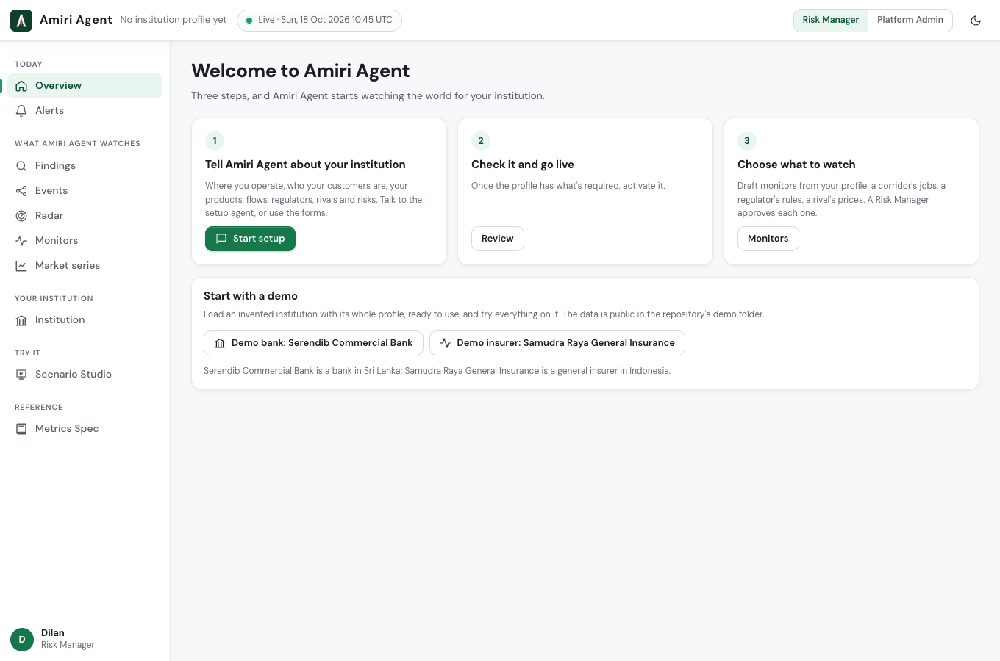
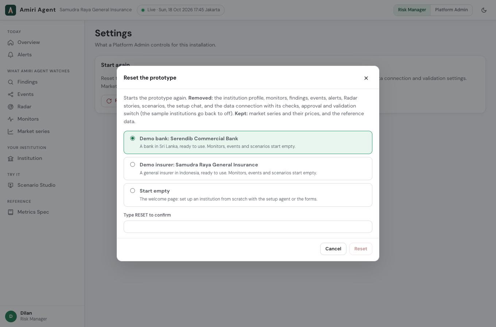
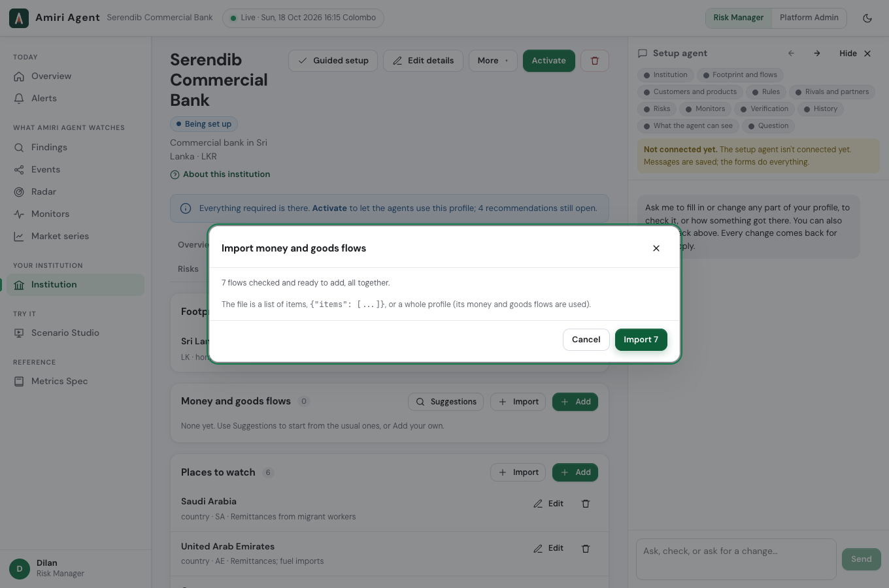

# Demo data

Two demo institutions for trying Amiri Agent. Both are **invented**: no real bank or insurer has these names. Real
firms appear only as their rivals, regulators and partners, by their public names.

| Folder | Institution | Where | What it is |
|---|---|---|---|
| [`serendib-commercial-bank/`](serendib-commercial-bank/) | Serendib Commercial Bank | Sri Lanka only (172 branches, none abroad) | A mid-size commercial bank: deposits and pawning, SME lending, trade finance, cards, remittances from Gulf workers |
| [`samudra-raya-general-insurance/`](samudra-raya-general-insurance/) | Samudra Raya General Insurance | Indonesia only (42 branches) | A mid-size general insurer: motor, property, marine, health, travel, with a sharia unit |

Each institution's `world.md` describes the real-world situation its monitors and scenarios are written for, with
dates and sources.

## The fastest way: one click



- **Empty platform:** on the **Home** page, under **Start with a demo**, press **Demo bank** or **Demo insurer**.
- **Platform already in use:** **Settings › Reset the prototype…** opens the **Reset the prototype** dialog. Choose
  **Demo bank** or **Demo insurer**, type RESET, then press **Reset**. This removes the current institution and
  everything made for it.



Either way loads the whole profile (steps 01 to 10 below) and makes it live. Market series, monitors, scenarios and the
Verification condition (steps 11 to 14) are yours to add from the files.

## File by file

Every folder is named after the **dialog or page title** in the app where its file is used, and numbered in the order
to load them. Later sections refer to earlier ones by `id`, so keep the order.

```
serendib-commercial-bank/                       (samudra-raya-general-insurance/ is laid out the same way)
├── world.md                                    the real-world situation the monitors and scenarios are written for
├── 01 Tell Amiri Agent about your institution/
│   ├── profile.json                            the whole profile: steps 01 to 10 in one file
│   └── institution.json                        the institution's own fields only
├── 02 Edit place in the footprint/footprint.json
├── 03 Import places to watch/watch-places.json
├── 04 Import customer groups/segments.json
├── 05 Import products/products.json
├── 06 Import money and goods flows/flows.json
├── 07 Import regulators and rules/regulators.json
├── 08 Import rivals/rivals.json
├── 09 Import firms you depend on/counterparties.json
├── 10 Import risk exposures/risk-exposures.json
├── 11 Add a series/series.json                 4 market series
├── 12 New monitor/01-….json …                  one monitor per file
├── 13 Write your own scenario/01-….json …      one Scenario Studio scenario per file
└── 14 The sample bank/conditions.json          (the insurer: 14 The sample insurer/)
```

| Folder | Where in the app | Do this |
|---|---|---|
| `01 Tell Amiri Agent about your institution` | **Institution** (with no institution yet) | **Import a whole profile (creates everything)** and choose `profile.json`. This does steps 01 to 10; skip to 11. Or, to go file by file: **Fill from a JSON file** with `institution.json`, then **Create and continue**. |
| `02 Edit place in the footprint` | **Institution › Footprint and flows › Footprint**, the home country's **Edit** | **Fill from a JSON file** with `footprint.json`, then **Save**. The home country is added when the institution is created; this sets its branch count. |
| `03` to `10`, `Import …` | **Institution**, the tab with that list: *Footprint and flows* (places to watch, flows), *Customers and products* (customer groups, products), *Rules* (regulators), *Rivals and partners* (rivals, firms you depend on), *Risks* (risk exposures) | The list's **Import** button, choose the file. The dialog of the same name checks every item first, then **Import** adds them all together. |
| (after 01 or 10) | **Institution** | **Activate**: the agents use the profile only once it is live. |
| `11 Add a series` | **Market series › Add a series** | **Fill from a JSON file** with `series.json`; it holds 4 series, so pick one at a time, then **Add**. Needs a market data key on the server. |
| `12 New monitor` | **Monitors › New monitor** | **Fill from a JSON file** with one monitor's file, then **Save and submit for approval**. A second person approves it. |
| `13 Write your own scenario` | **Scenario Studio**, the template for writing your own | **Fill from a JSON file** with one scenario's file, then **Create**. |
| `14 The sample bank` / `14 The sample insurer` | **Data connections › Sample institutions** | In that institution's card: **Fill from a JSON file** with `conditions.json`, **Save conditions**, switch the card on, then **Use it as the connection**, **Check**, approve, and switch validation on. The sample API's data then shows the effect (the bank: remittances fall; the insurer: floods, then relief), so Verification has something to confirm. |



## The figures

Every amount in the profiles comes from a named, published source. Each flow's `source.url` links to it. Where no
official figure by country is published, the flow has **no amount**, and its `note` says what is published instead.
Nothing is estimated. `world.md` lists the sources for the monitors and scenarios.

The `New monitor` and `Write your own scenario` files are written for the demo. "Reality check: the week of 12 October
2026" puts that week's real headlines in our own words; the other scenarios are invented what-ifs.

## For developers

These files are generated from the server's demo profiles (`server/app/seeds/serendib_bank.json`,
`server/app/seeds/samudra_raya_general.json`, `server/app/seeds/demo_extras.json` and the series in `server/app/demo.py`):

```sh
cd server && uv run amiri demo-export
```

`server/tests/test_demo_export.py` fails if this folder and the seeds drift apart. It also loads every file the way
this page describes. `README.md`, `world.md` and `images/` are written by hand. To seed a running server through its
API, with monitors approved, a recorded scenario and Verification on:
`uv run python scripts/demo_seed.py --server http://localhost:8000 --institution bank` (or `insurer`).
