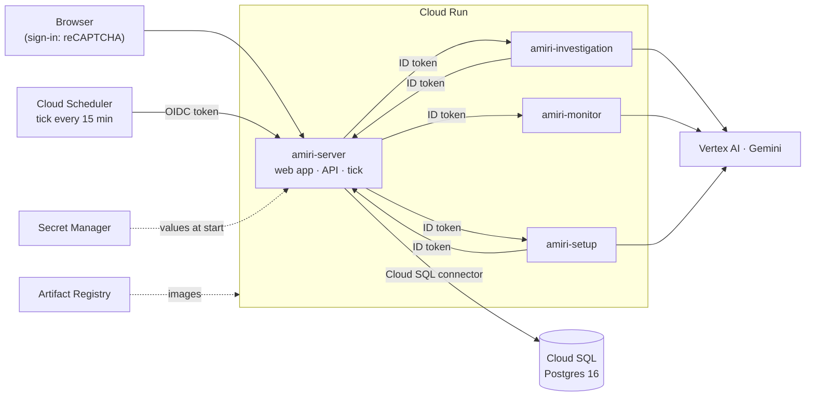

# Deploying Amiri Agent on Google Cloud

Everything runs in **your own Google Cloud project**: your keys and your bill. A new account gets free trial
credit, which covers a prototype for a long time. Terraform describes it all, and a few scripts do the parts
Terraform shouldn't (secrets, images, the on/off switch).



| What | Where |
|---|---|
| Terraform | `infra/terraform/` (`main.tf`: APIs, registry, secrets, database, budget · `iam.tf` · `run.tf`: services, tick) |
| Images | `server/Dockerfile` (web app + server), each agent's own `Dockerfile`; built by `infra/cloudbuild.yaml` |
| Scripts | `infra/scripts/`: `bootstrap.sh`, `deploy.sh`, `secrets.sh`, `build.sh`, `awake.sh` |

**Rules the setup keeps:**
- **No secret values in Terraform, its state or the repository.** Terraform makes empty Secret Manager
  secrets; `secrets.sh` fills them. It also makes the database user, so even the database password stays
  out of the state.
- **Nothing is applied without you seeing it.** `deploy.sh` shows the plan and asks.
- **One switch for the money.** `awake.sh off` stops the database and pauses the tick. The web app still
  opens and says it's paused. `awake.sh on` brings it back, with nothing lost.

---

## 1. What you need

- A Google Cloud project with **billing linked** (a free trial account is fine).
- [`gcloud`](https://cloud.google.com/sdk/docs/install) and [Terraform](https://developer.hashicorp.com/terraform/install)
  1.6 or later. On a Mac: `brew install --cask google-cloud-sdk` and `brew install hashicorp/tap/terraform`.
- Sign in, once: `gcloud auth login` and `gcloud auth application-default login`.
- A free [Twelve Data](https://twelvedata.com) API key (market series).
- Owner (or Editor + Security Admin) on the project. For the budget alert, Billing Account Administrator.

You don't need Docker: Cloud Build makes the images in your project.

## 2. Your settings

```bash
cd infra/terraform
cp terraform.tfvars.example terraform.tfvars    # git ignores it
```

Fill in `project_id`, `region` (for example `asia-south1`) and `operator_email` (your Google account). For a
budget alert, also fill in `billing_account_id` (from `gcloud billing accounts list`). Leave
`recaptcha_site_key` empty for now.

## 3. First time

```bash
infra/scripts/bootstrap.sh       # the private state bucket, then terraform init
infra/scripts/deploy.sh base     # APIs, registry, service accounts, empty secrets, the database (about 10 minutes)
```

### 3.1 The reCAPTCHA key

Your server's address is already known:

```bash
terraform -chdir=infra/terraform output -raw server_hostname    # amiri-server-<number>.<region>.run.app
```

At [google.com/recaptcha/admin](https://www.google.com/recaptcha/admin), make a key:
- **reCAPTCHA v2**, "I'm not a robot" checkbox;
- domain: that hostname (add `localhost` too if you want to test locally).

Put its **site key** in `terraform.tfvars` (`recaptcha_site_key = "…"`). Keep its **secret key** for the next step.

### 3.2 The secrets

```bash
infra/scripts/secrets.sh
```

It asks for the reCAPTCHA secret key and your Twelve Data key, without echoing them. It generates the session
secret, makes the database user with a random password, and offers to generate the access code people type
at sign-in. It shows a generated access code once: share it with whoever tests.

### 3.3 Images, then everything

```bash
infra/scripts/build.sh     # Cloud Build: the four images, tagged with the git commit (about 5–10 minutes)
infra/scripts/deploy.sh    # the services and the tick; shows the plan, asks, applies
```

### 3.4 Open it and set up your institution

```bash
terraform -chdir=infra/terraform output -raw server_url
```

**Use exactly this URL.** Cloud Run also lists an older-style address, but sign-in checks the hostname and only
this one is on the reCAPTCHA key. Sign in with the checkbox and the access code. Robots and AI crawlers are
told to stay away, and known ones are refused.

The install starts empty. Set up your bank or insurer on the Institution page (the setup chat or the forms), add
the prices and rates to watch on the Market series page, then draft and approve monitors from the profile.

---

## 4. Day to day

| Task | Command |
|---|---|
| **Stop paying for the database** (nobody is testing) | `infra/scripts/awake.sh off` |
| Start it again (a few minutes; the app wakes by itself) | `infra/scripts/awake.sh on` |
| Which is it? | `infra/scripts/awake.sh` |
| Ship new code | `infra/scripts/build.sh && infra/scripts/deploy.sh` |
| Change a setting | edit `terraform.tfvars` (`server_env = { … }` for any server setting), then `deploy.sh` |
| Replace a secret | `infra/scripts/secrets.sh RECAPTCHA_SECRET`, then `deploy.sh` (a running service reads secrets when it starts) |
| Run the tick now | `gcloud scheduler jobs run amiri-tick --location <region>` |
| Logs | §5: what went wrong recently, one request, one run |
| See what Terraform would change | `terraform -chdir=infra/terraform plan` |

**Keep it awake while people are reviewing.** Asleep, the app opens but only shows the paused page. Use
`awake.sh off` only when nobody needs it.

**What it costs.**
- **The database is the main cost while it runs**, and the trial credit covers it. Stopped, only its storage,
  backups and IP address are charged.
- **Cloud Run** scales to zero; its free tier covers a prototype's traffic.
- **Gemini** is charged per call, from the agents' work: monitor checks, investigations, setup-agent turns.
- **Cloud Build** has 2,500 free build-minutes a month.
- **Artifact Registry** keeps the last three images of each service (the free tier is 0.5 GB; beyond it, cents).
- **Secret Manager:** the five secrets fit its free tier, because `secrets.sh` destroys replaced versions.
- **reCAPTCHA:** 10,000 checks a month are free. The access code keeps bots from using them.
- **The budget alert** emails the billing account's admins at 50%, 90% and 100% of `budget_amount`.

## 5. Finding a problem

Every service writes **one JSON line per thing worth knowing**. Cloud Logging reads its severity, keeps a
traceback in one entry, and links the line to its trace. Nothing is logged per normal request: Cloud Run's
own request log already has those.

| Level | What is logged |
|---|---|
| INFO | one line per tick (what each step did, how long it took); one line per agent run or setup-chat turn (model, counts, time); sign-ins; the database waking |
| WARNING | an agent run that failed or broke the contract; a tick step that failed (the other steps still run); a series whose Twelve Data fetches start failing (once, not every hour); a model failing over to the next; sign-in refused by reCAPTCHA (with the hostname it saw); the daily reCAPTCHA cap reached; the database unreachable (once) |
| ERROR | unexpected exceptions, with the traceback in one entry |

**Never logged:** prompts, model answers, what people type into the chat, IP addresses. Agent traces leave out
the prompt text too. They keep timings, model and tool calls, so a slow or failing run is still easy to follow.

**What went wrong in the last day** (all services):

```bash
gcloud logging read 'resource.type="cloud_run_revision" AND severity>=WARNING' --freshness=1d --limit=50 \
  --format='table(timestamp, resource.labels.service_name, severity, jsonPayload.message)'
```

In the console, open **Logs Explorer** with the same filter. Narrow it with these:

| To see | Add |
|---|---|
| one service | `resource.labels.service_name="amiri-server"` (or `amiri-investigation`, `amiri-monitor`, `amiri-setup`) |
| the ticks | `jsonPayload.logger="amiri.tick"` |
| agent runs, chat turns, model failovers | `jsonPayload.logger=~"^app\.(runs\|engine\|models)"` |
| sign-in | `jsonPayload.logger="amiri.auth"` |
| a run or turn by id | `jsonPayload.message:"inv-20261014…"` |
| the tick's own calls (Scheduler) | `resource.type="cloud_scheduler_job"` instead of Cloud Run |

**Everything one request did:** open any of its lines and choose *Show entries for this trace*. The trace
(**Trace Explorer**) shows the time each step took, down to each model and tool call in an agent.

**Errors, grouped:** the **Error Reporting** page lists each distinct traceback once, with how often and when
it happened. Turn on its notifications to get an email for a new kind of error.

**More or less detail:** set `log_level` in `terraform.tfvars`, then run `deploy.sh`. `WARNING` is quieter;
`DEBUG` is for chasing one problem, and goes back afterwards.

**Cost.** Cloud Logging is free up to 50 GiB a month per project. At these levels the services write a few MB
a day, so the free allowance covers it many times over. The **Logs Storage** page shows the month's volume.

## 6. When something is wrong

| What you see | Why, and what to do |
|---|---|
| `deploy.sh`: "No image_tag yet" | Run `build.sh` first |
| A service won't start: "secret … has no versions" | Run `secrets.sh` (every secret needs a value before the services) |
| The app says "paused" | The database is stopped: `awake.sh on`, wait a few minutes, then "Check again" |
| Sign-in: "the check failed" | The reCAPTCHA key doesn't list the hostname you opened: use the `server_url` output |
| Setting `allUsers` fails | An organisation policy forbids public services (domain-restricted sharing). Use a project outside that organisation |
| `build.sh`: permission denied on the build account | Your account needs to act as `amiri-build` (Owner has it) |
| A script against the API (as the ops account): 401 | The token's audience must be exactly the `server_url` output, with `--include-email` |
| The tick fails with 401 | The scheduler account must be in the server's `INTERNAL_CALLERS` (Terraform sets it). Check that `server_url` matches the service's address |

## 7. Taking it down

```bash
# 1. allow deleting the database: in terraform.tfvars, protect_database = false
infra/scripts/deploy.sh
# 2. then everything (the database and its data are gone for good)
terraform -chdir=infra/terraform destroy
```

The state bucket (`<project>-amiri-tfstate`) stays; delete it by hand if you want. Or delete the whole project.

## 8. Later

- **Radar:** once its agent exists, add an `amiri-radar` service like the others, with `roles/bigquery.jobUser`
  on its account and the server allowed to call it. Then set `radar_url`. Keep `radar_daily_bytes_cap`
  within BigQuery's free terabyte a month.
- **Google sign-in** in place of the reCAPTCHA prototype sign-in.
- **A custom domain**, then a reCAPTCHA key for it.
